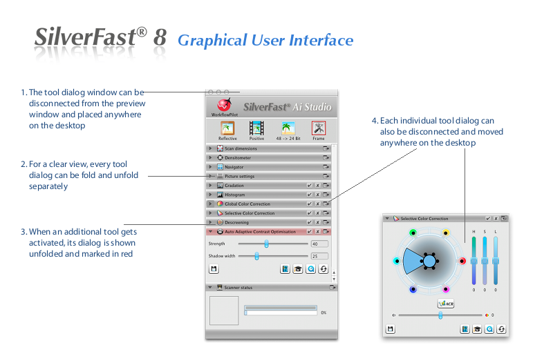
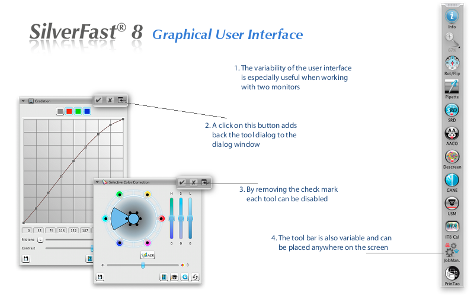

# SilverFast Makes Color Decisions Before Final Delivery

A scan can preserve the source for later interpretation or deliver an already optimized image.
SilverFast connects scanner control, film conversion, color calibration, and subsequent processing through distinct products.

[](https://silverfast-software.github.io/SilverFast-Studio/)

## Establish the scanner profile before judging the color

A scanner profile describes a device's color response under the conditions used to create it.
Keep that role separate from the adjustments used to make an individual image look right.
A monitor profile describes another device in the viewing chain.

SilverFast Ai Studio includes automatic IT8 calibration.
LaserSoft's barcode-equipped targets allow the calibration assistant to obtain the appropriate reference data.
Use the target and reference information intended for the calibration procedure.

### Keep the calibration conditions identifiable

- Record the scanner model and software version.
- Identify the target and its matching reference data.
- Use the appropriate reflective or transparency workflow.
- Keep the resulting profile associated with the capture conditions.
- Review a representative scan in a color-managed viewer.

Do not replace a correct profile merely because one faded photograph needs a different rendering.
Separate a source color cast from a problem affecting the whole viewing chain.



### Follow the separate parts of a color-managed pipeline

The companion darktable [thumbnail_color_management.txt](doc/thumbnail_color_management.txt) discusses color handling for thumbnails.
[display_presentation.md](dev-doc/display_presentation.md) describes presenting rendered images on screen.
The white-balance and color-calibration [README.md](dev-doc/iop/wb_and_colorcalibration/README.md) documents shared processing state.
The color-harmonizer [README.md](dev-doc/iop/colorharmonizer/README.md) describes a creative hue-adjustment module.

Color conversion and a creative palette adjustment serve different purposes.
The build references [FindLCMS2.cmake](cmake/modules/FindLCMS2.cmake), [FindColord.cmake](cmake/modules/FindColord.cmake), and [FindColordGTK.cmake](cmake/modules/FindColordGTK.cmake) locate color-management dependencies.
[FindExiv2.cmake](cmake/modules/FindExiv2.cmake) locates a metadata library.
The manual [darktable-cmstest.pod](doc/man/darktable-cmstest.pod) describes inspecting the computer's color-management configuration.

## Choose where image interpretation will happen

SilverFast Ai Studio operates the scanner.
SilverFast HDR Studio processes previously captured image data.
Archive Suite combines those products into a capture-and-processing workflow.

| Intended workflow | Scanner-side product | Later processing | Preserve for another interpretation |
| --- | --- | --- | --- |
| Produce an optimized scan now | Ai Studio | Optional further editing of the output | A separate source capture if required |
| Capture an archive for later work | Ai Studio with a supported RAW workflow | HDR Studio | The original high-bit capture |
| Produce several renditions from one archive | The original capture stage | HDR Studio for each rendition | Original data plus the relevant settings |

An ordinary finished TIFF and an HDRi capture have different roles.
A file extension alone does not describe every channel or correction already applied.

### Understand the purpose of HDRi

SilverFast's HDRi RAW workflow can retain image data, color-management information, and, where available, infrared data.
HDR or HDR Studio processes the captured data into optimized outputs.
Keep the original capture when producing a different rendering for another use.

Infrared information depends on scanner support.
Confirm the specific model's compatibility before expecting a retained infrared channel.
A capture can only preserve information that the hardware actually acquires.

### Retain processing state as well as image files

The companion [Core_Concepts.md](dev-doc/Core_Concepts.md) explains darktable's source images and edit history.
[pixelpipe_architecture.md](dev-doc/pixelpipe_architecture.md) describes its processing pipeline.
[Module_Lifecycle.md](dev-doc/Module_Lifecycle.md) follows processing callbacks and updates.

The separate [dtdata_sidecar.md](dev-doc/dtdata_sidecar.md) documents per-pixel sidecar data.
[masks_data_model.md](dev-doc/masks_data_model.md) describes mask representation.
[Catalog_Access.md](dev-doc/Catalog_Access.md) concerns access to darktable's image library.

Those references illustrate why an editable project may contain more than the source image.
For a SilverFast archive, retain the files and settings that its own workflow requires.
Verify a copied archive by reopening it in the intended processing application.

## Evaluate dynamic range, film conversion, and defects separately

A dark region, a color cast, and a dust spot are different problems.
Choose a correction according to the source of the problem.

### Recover tonal information through supported capture features

SilverFast Multi-Exposure combines captures made with different exposure settings.
Its purpose is to improve usable dynamic range on supported scanners.
Inspect dense slide regions and shadows when comparing the result.

Keep the scanner's hardware limits in mind.
More tonal information and more spatial resolution are different outcomes.
A sharper-looking edge does not establish improved shadow detail.

The companion [HDR_Alignment_Design.md](dev-doc/HDR_Alignment_Design.md) discusses darktable's HDR-merge alignment design.
It is useful background for understanding that combining captures involves alignment as well as tone.
It does not document SilverFast's Multi-Exposure implementation.

### Convert the negative using an appropriate starting profile

SilverFast NegaFix provides film profiles and controls for negative-to-positive conversion.
Select the film type when it is known.
Compare important colors and neutral areas before making a correction across a whole strip.

Record uncertainty if the film stock cannot be identified.
Keep an unchanged capture when another conversion may be needed later.
A pleasing positive and a faithful reproduction are related judgments, but they need separate review.

### Match defect removal to the film and scanner

iSRD uses the scanner's infrared information for dust and scratch removal.
Traditional silver-based black-and-white film is unsuitable for that infrared method.
Kodachrome has its own documented considerations and dedicated mode.

SilverFast also offers software-based SRDx correction.
Compare fine texture and small details before accepting a strong setting.
Limit corrections to the affected areas when the available controls allow it.



## Prepare each frame before processing the batch

A group of frames does not necessarily share the same exposure or correction needs.
Confirm crop boundaries and orientation before unattended processing.

SilverFast JobManager can scan multiple frames in sequence and batch-process previously captured RAW files.
The documented controls include copying adjustments and saving or loading frame sets.
Copy only the settings that make sense for the selected group.

### Keep the repeatable decisions separate from exceptions

- Give each frame a stable identifier.
- Confirm which corrections are shared.
- Keep unusual crops or film types identifiable.
- Review destination names before beginning the batch.
- Check several completed outputs before continuing with more material.

The companion [Quick_Access_Panel.md](dev-doc/Quick_Access_Panel.md) describes gathering frequently used darktable controls.
[sliders.md](dev-doc/sliders.md) explains its slider implementation and displayed values.
[Shortcuts.md](dev-doc/Shortcuts.md) documents the action and shortcut system.
[grouping.txt](doc/grouping.txt) records image-grouping behavior.

For SilverFast, use its documented JobManager and frame controls.
Retain exceptions so a later batch correction does not erase a frame-specific choice.

## Render a conventional positive with its editing instructions

Export a normal positive image before using a general photographic editor.
Confirm its color profile, bit depth, and whether defect correction has already been applied.
Do not assume that another application understands the complete HDRi processing workflow.

This command uses darktable-cli with a regular TIFF positive and an existing darktable XMP sidecar.
The sidecar must contain the adjustments intended for that image.
The output is limited to 1600 pixels in width and height without upscaling.

```sh
darktable-cli "frame-positive.tif" "frame-positive.tif.xmp" "frame-proof.jpg" --width 1600 --height 1600 --upscale false
```

Choose an unused output filename.
Review the rendered JPEG in a color-managed viewer.
The command does not perform a SilverFast scan or interpret a SilverFast settings file.

The supplied [darktable-cli.pod](doc/man/darktable-cli.pod) documents the arguments and optional XMP.
[darktable.pod](doc/man/darktable.pod) describes the main application.
The manual-authoring [README.md](doc/man/README.md) explains the documentation's POD format.

## Convert a sharing copy through its actual input profile

Converting between profiles changes pixel values to preserve color appearance in the destination space.
Assigning a profile without conversion is a different operation.
Choose the source profile according to the image data that was actually exported.

This Python example uses Pillow's ImageCms support for an already rendered eight-bit RGB TIFF.
The TIFF must contain a valid embedded ICC profile that correctly describes its pixels.
The new JPEG receives the sRGB profile used for the conversion.

```python
from io import BytesIO
from PIL import Image, ImageCms
with Image.open("positive-8bit.tif") as image:
    assert image.mode == "RGB"
    source = ImageCms.ImageCmsProfile(BytesIO(image.info["icc_profile"]))
    target = ImageCms.ImageCmsProfile(ImageCms.createProfile("sRGB"))
    converted = ImageCms.profileToProfile(image, source, target, outputMode="RGB")
    with open("positive-web.jpg", "xb") as output:
        converted.save(output, "JPEG", quality=90, icc_profile=target.tobytes())
```

The example creates a separate derivative and does not carry over every metadata field.
Keep the high-bit archival original and its identifying information separately.
Use an appropriate high-bit workflow when preparing further editing masters.

### Check format support in the receiving application

The companion [FindOpenEXR.cmake](cmake/modules/FindOpenEXR.cmake), [FindJXL.cmake](cmake/modules/FindJXL.cmake), and [FindWebP.cmake](cmake/modules/FindWebP.cmake) locate image-format dependencies.
[Findlibheif.cmake](cmake/modules/Findlibheif.cmake) and [Findlibraw.cmake](cmake/modules/Findlibraw.cmake) locate additional decoding libraries.
They are build resources; their presence alone does not establish which codecs a particular installed application includes.

For a problem report, record the actual application version and export choice.
Keep a small image that demonstrates the issue and the profile information associated with it.
Distinguish a file that fails to open from one that opens with an unexpected appearance.

The companion [DefineOptions.cmake](DefineOptions.cmake) declares darktable build options.
[ConfigureChecks.cmake](ConfigureChecks.cmake) performs configuration checks, while [CMakeLists.txt](CMakeLists.txt) defines the main build.
The supplied [README.md](doc/README.md) is another darktable documentation resource.

Consult the official [Ai Studio overview](https://www.silverfast.com/products-overview-products-company-lasersoft-imaging/silverfast-scanner-software/silverfast-ai-studio/),
[Archive Suite guide](https://www.silverfast.com/silverfast-archive-suite/),
and [feature overview](https://www.silverfast.com/about-silverfast-why-scanning-basics-of-scanning/why-silverfast/silverfast-feature-highlights/) for native controls and edition requirements.

## Related Search Terms

SilverFast Software, SilverFast Studio, lasersoft silverfast, lasersoft imaging silverfast, silverfast ai studio, photography, scanner, image-processing, color-management, film-scanning, film-negative, negative-conversion, raw, twain, windows
